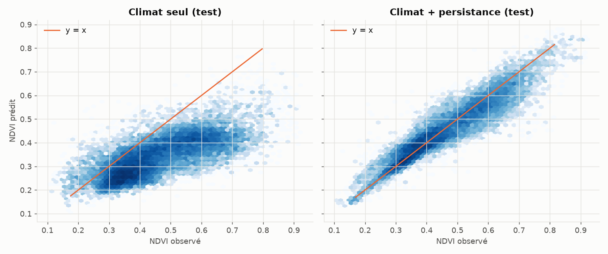
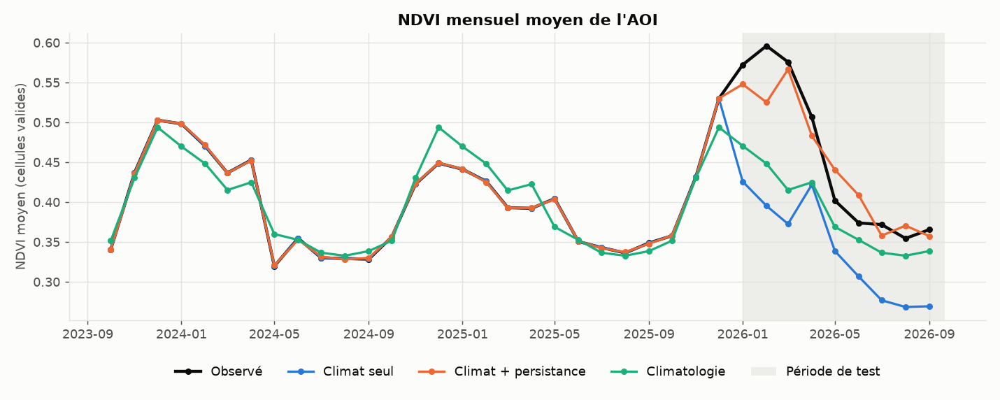
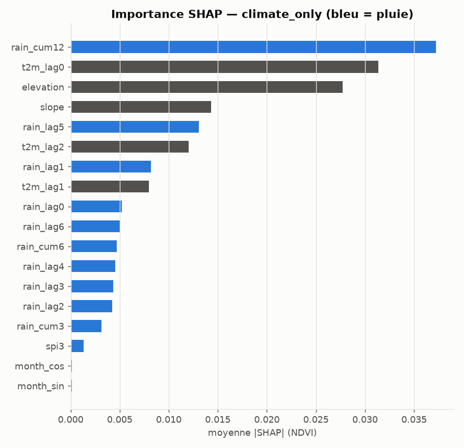
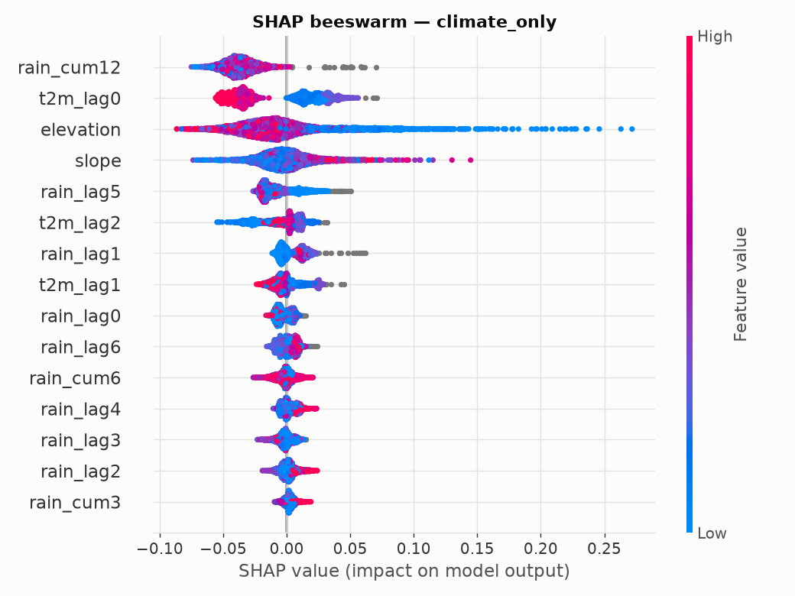
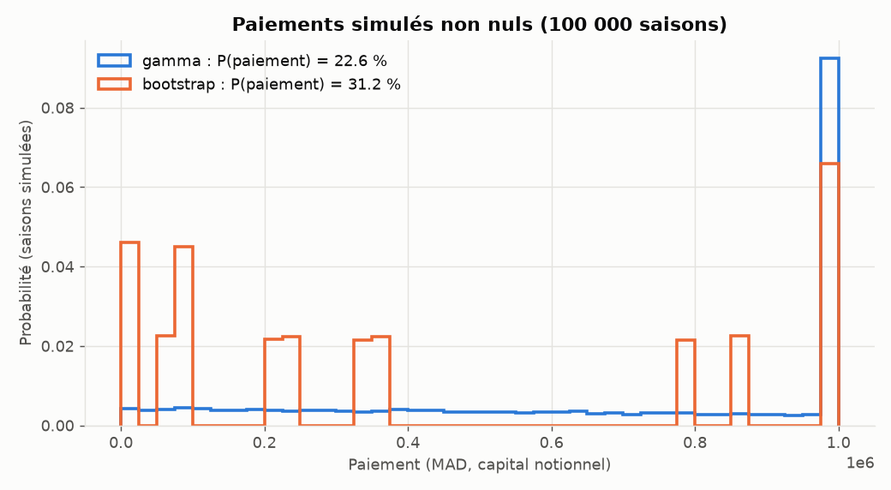
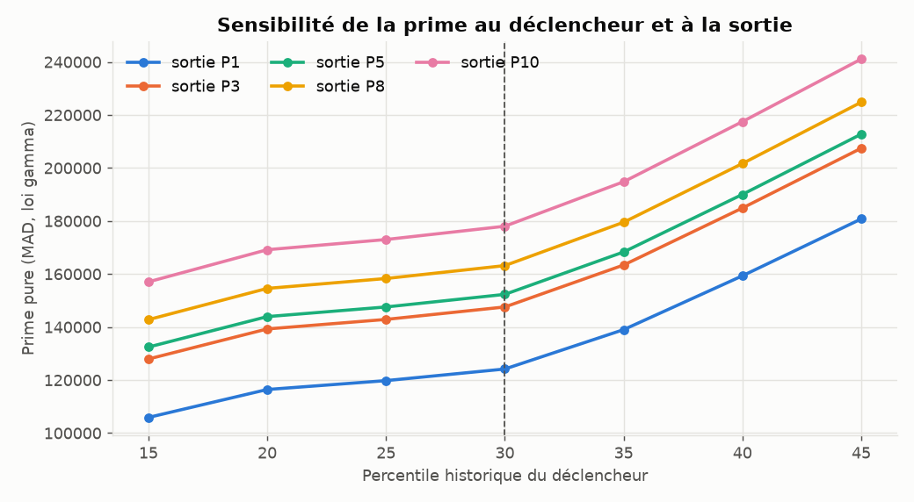
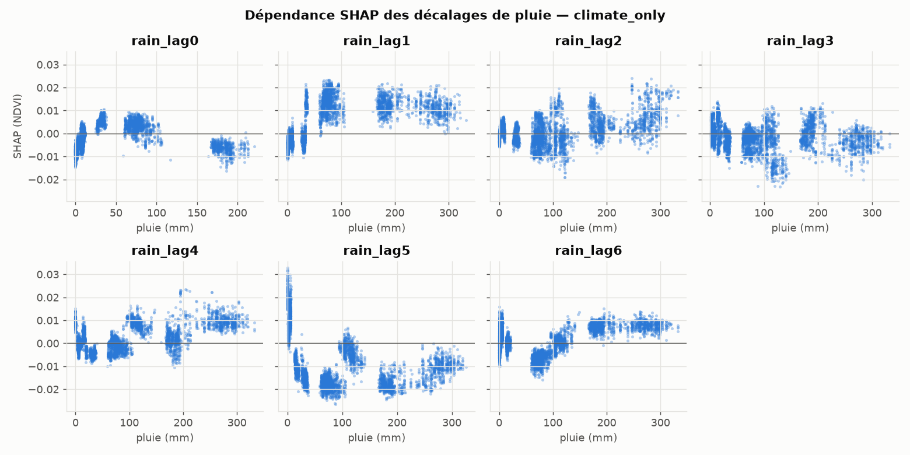
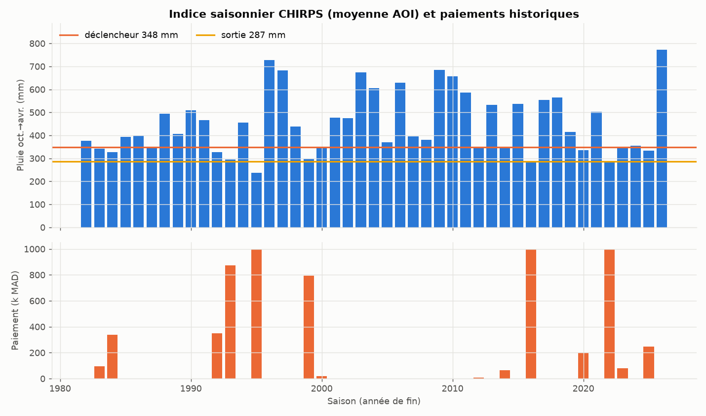
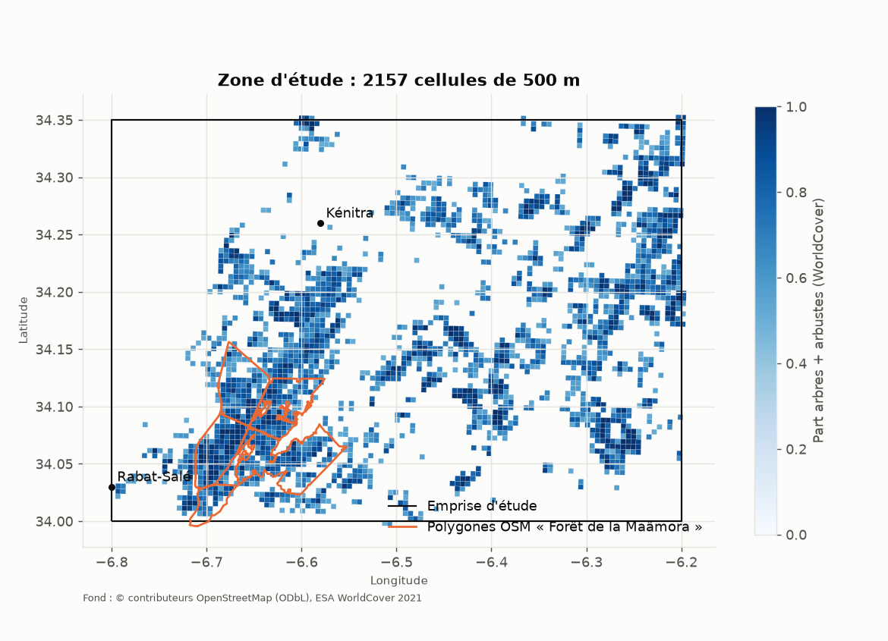
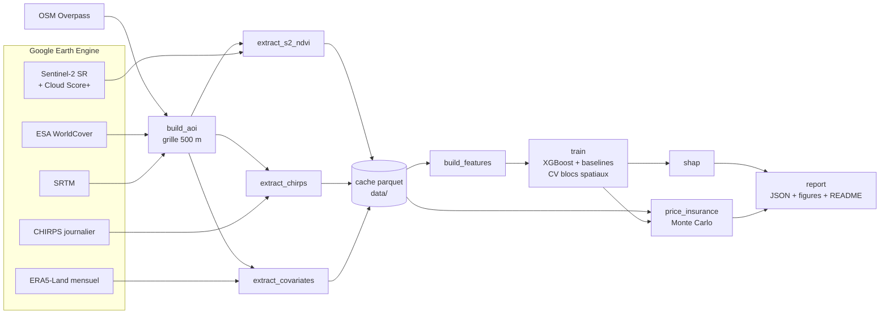

# Maâmora Green Recovery

> Suivre la végétation de la forêt de la Maâmora (Maroc) par satellite, relier sa dynamique à la pluie, et tarifer une assurance paramétrique sécheresse illustrative.

> **Avertissement** : projet illustratif. Le capital assuré est **notionnel** ; rien ici ne constitue une offre d'assurance.

## Résultats

Tous les chiffres de cette section sont générés par `python -m maamora.cli report` à partir de [`reports/metrics.json`](reports/metrics.json) et [`reports/insurance_pricing.json`](reports/insurance_pricing.json). Ils sont publiés tels quels.

<!-- RESULTS:START -->
(généré par `.\tasks.ps1 report`)
<!-- RESULTS:END -->

### Figures

| | |
|---|---|
|  |  |
|  |  |
|  |  |





Autres figures : [variante persistance (SHAP)](reports/figures/shap_importance_climate_persistence.png), [risque de base](reports/figures/basis_risk.png).

## Analyse

Voir la section « Lecture des résultats » de [docs/METHODOLOGY.md](docs/METHODOLOGY.md).

## Zone d'étude



OpenStreetMap ne contient que quelques polygones « Forêt de la Maâmora » couvrant la partie ouest du massif (~118 km² sur ~1 300 km²). Conformément au cahier des charges, l'AOI est donc l'emprise lon −6,80 → −6,20, lat 34,00 → 34,35, restreinte aux cellules de 500 m composées d'au moins 50 % d'arbres ou d'arbustes selon ESA WorldCover 2021. Les polygones OSM sont affichés pour référence (© contributeurs OpenStreetMap, licence ODbL).

## Architecture



Le même enchaînement est exécuté par la CLI (`.\tasks.ps1 run`) ou par le DAG Airflow `maamora_pipeline` (`dags/maamora_dag.py`).

## Méthodologie (résumé)

- **Masque nuages** : Cloud Score+ (`cs_cdf` ≥ 0,60), SCL en secours si la bande manque ; NDVI = (B8 − B4)/(B8 + B4) ; masque végétation WorldCover (arbres, arbustes).
- **Cible** : médiane mensuelle du NDVI par cellule ; un mois sans observation suffisante est **manquant**, jamais interpolé.
- **Features** : pluie CHIRPS décalée de 0 à 6 mois, cumuls 3/6/12 mois, SPI-3 (loi gamma ajustée sur 1981 → veille de la fenêtre), température ERA5-Land décalée de 0 à 2 mois, saisonnalité, altitude, pente ; variante persistance avec NDVI t−1 et t−12.
- **Absence de fuite temporelle** : décalages vers le passé uniquement sur un index mensuel complet, testé par `tests/test_features.py::test_no_future_information` (perturber le futur ne change aucune feature passée).
- **Découpe test** : 27 premiers mois en entraînement (hyperparamètres choisis sur les 6 derniers mois de l'entraînement), **9 derniers mois en test**, jamais utilisés pour régler quoi que ce soit.
- **Robustesse** : validation croisée par blocs spatiaux de 5 km comparée à un K-fold aléatoire.
- **Assurance** : indice = cumul CHIRPS oct. → avr. moyenné sur l'AOI ; paiement linéaire entre P30 et P5 ; 100 000 saisons simulées (loi gamma et bootstrap, graine fixe) ; prime technique = prime pure + 6 % × (VaR 99 % − prime pure).

Détails : [docs/METHODOLOGY.md](docs/METHODOLOGY.md), décisions : [docs/DECISIONS.md](docs/DECISIONS.md), données : [docs/DATA.md](docs/DATA.md).

## Données et sources

| Source | Usage | Licence / attribution |
|---|---|---|
| Copernicus Sentinel-2 L2A (`COPERNICUS/S2_SR_HARMONIZED`) | NDVI | Contient des données Copernicus Sentinel modifiées |
| Cloud Score+ (`GOOGLE/CLOUD_SCORE_PLUS/V1/S2_HARMONIZED`) | masque nuages | Google, CC-BY 4.0 |
| CHIRPS (`UCSB-CHG/CHIRPS/DAILY`) | pluie | Funk et al. 2015, CHC UCSB |
| ERA5-Land (`ECMWF/ERA5_LAND/MONTHLY_AGGR`) | température | Copernicus Climate Change Service |
| SRTM (`USGS/SRTMGL1_003`) | altitude, pente | NASA / USGS |
| ESA WorldCover 2021 (`ESA/WorldCover/v200`) | masque végétation | © ESA WorldCover project, CC-BY 4.0 |
| OpenStreetMap (Overpass API) | contour de référence | © contributeurs OpenStreetMap, ODbL |

## Limites

- **36 mois seulement** : 27 mois d'entraînement, soit 2 à 3 occurrences de chaque mois calendaire ; le test (9 mois) ne couvre qu'une partie d'un cycle saisonnier.
- **Autocorrélation spatiale** : les cellules voisines partagent la même pluie (CHIRPS à ~5,5 km, ERA5 à ~11 km) ; les métriques par cellule surestiment le nombre d'observations indépendantes. L'écart entre CV aléatoire et CV par blocs le quantifie.
- **AOI approximative** : emprise rectangulaire + WorldCover, pas le périmètre officiel de la forêt ; plantations et vergers peuvent être inclus.
- **Capital notionnel** de 1 000 000 MAD ; pas de frais de gestion, de taxes ni de réassurance dans la prime.
- **Risque de base** : l'indice pluie n'explique qu'une partie de la dynamique du NDVI ; mesuré sur une fenêtre de 36 mois, donc avec très peu de saisons.
- **Stationnarité** : la loi gamma et le bootstrap supposent un climat stationnaire depuis 1981 (voir le test de tendance).

## Reproduire

1. **Earth Engine** : un projet Google Cloud enregistré pour Earth Engine (usage non commercial). Authentifiez-vous une fois (`earthengine authenticate`) : les identifiants restent dans votre profil utilisateur (`%USERPROFILE%\.config\earthengine`), hors du repo. Copiez `.env.example` en `.env` et renseignez `GEE_PROJECT`.
2. **Installation** (Windows PowerShell, Python 3.11) :
   ```powershell
   .\tasks.ps1 setup
   .\tasks.ps1 test
   ```
3. **Pipeline complet** (extractions mises en cache dans `data/`, relançable sans ré-extraction) :
   ```powershell
   .\tasks.ps1 run
   ```
   Étapes individuelles : `python -m maamora.cli <build-aoi|extract-s2|extract-chirps|extract-covariates|build-features|train|shap|price|report>`.
4. **Airflow** (Docker Desktop) :
   ```powershell
   .\tasks.ps1 airflow-up   # http://localhost:8080, DAG maamora_pipeline
   ```
   Le dossier d'identifiants Earth Engine est monté **en lecture seule** dans le conteneur (variable `EE_CREDENTIALS_DIR`, par défaut `%USERPROFILE%\.config\earthengine`) ; il n'est jamais copié.

## Structure du projet

```
src/maamora/
  config.py, cli.py, retry.py
  gee/        auth, aoi, sentinel2, chirps, covariates, extract (lots + cache)
  features/   build (lags, cumuls, SPI-3, saisonnalité, persistance)
  model/      split, train, evaluate, shap_analysis
  insurance/  index, payout, montecarlo, pricing, basis_risk
  reporting/  figures, report
aoi/          contour d'étude + polygones OSM de référence
configs/      default.yaml (configuration unique)
dags/         maamora_dag.py
docs/         PLAN, DECISIONS, METHODOLOGY, DATA
reports/      metrics.json, insurance_pricing.json, figures/
tests/        tests pytest hors réseau
```

---

*Illustratif, pas une offre d'assurance.*
