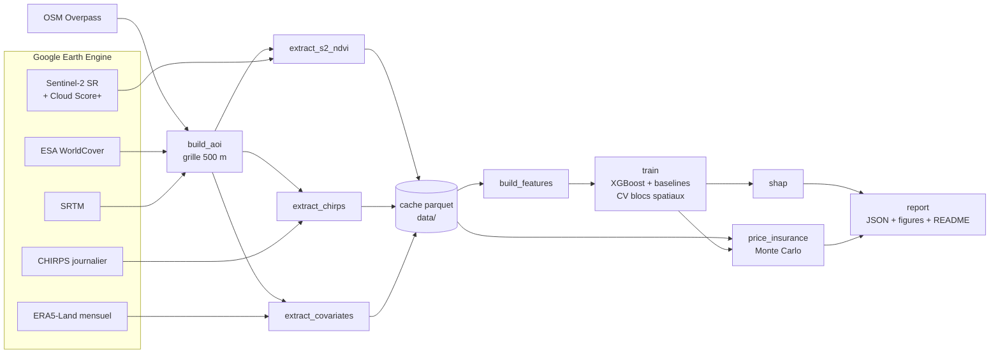

# Maâmora Green Recovery

> Suivre la végétation de la forêt de la Maâmora (Maroc) par satellite, relier sa dynamique à la pluie, et tarifer une assurance paramétrique sécheresse illustrative.

> **Avertissement** : projet illustratif. Le capital assuré est **notionnel** ; rien ici ne constitue une offre d'assurance.

## Résultats

Tous les chiffres de cette section sont générés par `python -m maamora.cli report` à partir de [`reports/metrics.json`](reports/metrics.json) et [`reports/insurance_pricing.json`](reports/insurance_pricing.json). Ils sont publiés tels quels.

<!-- RESULTS:START -->
Fenêtre : **2023-10 → 2026-09** (36 mois), **2157 cellules** de 500 m. Entraînement 2023-10 → 2025-12 (57803 lignes), test 2026-01 → 2026-09 (19352 lignes valides, dont 19291 où tous les modèles sont définis).

### Prédiction du NDVI sur la période de test (9 derniers mois)

| Modèle | R² | RMSE | MAE | n | R² (toutes lignes valides) |
|---|---|---|---|---|---|
| XGBoost climat seul | -0.197 | 0.1510 | 0.1249 | 19291 | -0.198 (n=19352) |
| XGBoost climat + persistance | 0.873 | 0.0492 | 0.0362 | 19291 | 0.867 (n=19352) |
| Baseline climatologie | 0.410 | 0.1059 | 0.0814 | 19291 | 0.408 (n=19352) |
| Baseline persistance (t−1) | 0.814 | 0.0595 | 0.0422 | 19291 | 0.814 (n=19291) |

Décalage de distribution entre entraînement et test (diagnostic a posteriori) :

| Variable | Max train | Max test | Moyenne train | Moyenne test | Part du test > max train |
|---|---|---|---|---|---|
| `rain_cum6` | 475 | 821 | 182 | 459 | 55.4 % |
| `rain_cum12` | 742 | 936 | 367 | 798 | 89.9 % |
| `rain_lag0` | 332 | 227 | 42 | 43 | 0.0 % |
| `ndvi_target` | 0.935 | 0.921 | 0.400 | 0.457 | 0.0 % |

R² de la moyenne mensuelle de l'AOI (9 points) : XGBoost climat seul -0.693, XGBoost climat + persistance 0.889, Baseline climatologie 0.194, Baseline persistance (t−1) 0.770.

### Validation croisée sur l'entraînement : aléatoire vs blocs spatiaux de 5 km

| Variante | R² KFold aléatoire | R² blocs spatiaux | Écart |
|---|---|---|---|
| XGBoost climat seul | 0.805 | 0.387 | 0.417 |
| XGBoost climat + persistance | 0.932 | 0.921 | 0.011 |

### SHAP (échantillon du test)

- **XGBoost climat seul** : feature la plus importante `rain_cum12` ; décalage de pluie dominant `rain_lag5` (5 mois, rang 5 toutes features confondues) ; feature pluie la plus importante `rain_cum12`.
- **XGBoost climat + persistance** : feature la plus importante `ndvi_lag1` ; décalage de pluie dominant `rain_lag2` (2 mois, rang 2 toutes features confondues) ; feature pluie la plus importante `rain_lag2`.

### Assurance paramétrique sécheresse (illustratif)

Indice : Cumul CHIRPS mois 10 → 4, moyenne AOI, 45 saisons (1982 → 2026), moyenne 451 mm. Déclencheur P30 = **348 mm**, sortie P5 = **287 mm**, capital **notionnel** 1 000 000 MAD.

| Mesure | Loi gamma | Bootstrap |
|---|---|---|
| Prime pure E[paiement] | 152 324 MAD | 133 781 MAD |
| Taux de prime pure | 15.23 % | 13.38 % |
| Chargement (CoC 6 % × (VaR − E)) | 50 861 MAD | 51 973 MAD |
| **Prime technique** | **203 185 MAD** | **185 755 MAD** |
| Écart-type | 326 246 MAD | 294 463 MAD |
| VaR 99 % | 1 000 000 MAD | 1 000 000 MAD |
| TVaR 99 % | 1 000 000 MAD | 1 000 000 MAD |
| Probabilité de paiement | 22.6 % | 31.2 % |

Burning cost historique : 134 914 MAD par an (13.49 %), 14 saisons avec paiement. Ajustement gamma : test KS p = 0.53. Tendance de l'indice : Mann-Kendall τ = 0.06 (p = 0.584), pente OLS 1.48 mm/an (p = 0.348) — pas de tendance significative à 5 %.

Risque de base (fenêtre de 36 mois) : corrélation entre le cumul de pluie glissant sur 7 mois et l'anomalie de NDVI observée r = 0.61 (p = 0.000, n = 36) ; avec l'anomalie prédite par le modèle climat seul r = -0.24 (n = 36). Seulement 3 saisons complètes dans la fenêtre : ces corrélations sont indicatives.
<!-- RESULTS:END -->

### Figures

| | |
|---|---|
|  |  |
|  |  |
|  |  |


Autres figures : [variante persistance (SHAP)](reports/figures/shap_importance_climate_persistence.png), [risque de base](reports/figures/basis_risk.png).

## Analyse

- **Le modèle « climat seul » échoue sur le test** : son R² est négatif, en dessous de la simple climatologie. Ce n'est pas un défaut de code mais un **décalage de distribution** : l'hiver 2025-26, qui ouvre la période de test, est le plus pluvieux de la fenêtre (voir le tableau de décalage ci-dessus et la dernière barre de la figure burning cost), la quasi-totalité des lignes de test ont un cumul de pluie sur 12 mois supérieur au maximum vu à l'entraînement, et le NDVI moyen est nettement plus élevé. Un modèle à arbres ne peut pas extrapoler au-delà des valeurs de features apprises : il prédit au mieux un « bon hiver » de la période d'entraînement, puis s'effondre au printemps. Avec 27 mois d'apprentissage, le modèle n'a vu que deux saisons des pluies, toutes deux sèches à modérées.
- **Le modèle « climat + persistance » est le meilleur** et bat la baseline de persistance : le NDVI du mois précédent porte l'essentiel de l'information, les variables climatiques ajoutent une correction modeste mais réelle.
- **Autocorrélation spatiale** : pour la variante climat seul, l'écart entre K-fold aléatoire et blocs spatiaux est très important. Un K-fold aléatoire mélange des cellules voisines qui partagent la même pluie CHIRPS et surestime fortement la performance. La variante persistance y est peu sensible.
- **Facteur pluie dominant (SHAP)** : dans la variante climat seul, c'est le **cumul sur 12 mois** qui domine, et le décalage mensuel le plus important est de 5 mois. Dans la variante persistance, le décalage de **2 mois** est le premier facteur pluie (2ᵉ feature après le NDVI t−1). Le repère « pluies des 2 mois précédents » n'est donc retrouvé que dans la variante persistance ; sans persistance, le modèle s'appuie sur des cumuls plus longs, cohérents avec la réponse lente d'une forêt de chêne-liège.
- **Assurance** : avec un déclencheur au 30ᵉ percentile, la prime pure représente une part importante du capital (voir le tableau) car le contrat paie souvent, et la VaR 99 % atteint le capital total. Gamma et bootstrap donnent des primes proches ; l'ajustement gamma n'est pas rejeté par le test KS et aucune tendance significative de l'indice n'est détectée depuis 1982. Les probabilités de paiement diffèrent davantage : la loi gamma lisse la queue basse.
- **Risque de base** : le cumul de pluie glissant est nettement corrélé à l'anomalie de NDVI observée sur la fenêtre, mais l'anomalie prédite par le modèle climat seul ne l'est pas (elle hérite de son échec hors distribution). Avec trois saisons, aucune conclusion saisonnière n'est possible.

## Zone d'étude


OpenStreetMap ne contient que quelques polygones « Forêt de la Maâmora » couvrant la partie ouest du massif (~118 km² sur ~1 300 km²). Conformément au cahier des charges, l'AOI est donc l'emprise lon −6,80 → −6,20, lat 34,00 → 34,35, restreinte aux cellules de 500 m composées d'au moins 50 % d'arbres ou d'arbustes selon ESA WorldCover 2021. Les polygones OSM sont affichés pour référence (© contributeurs OpenStreetMap, licence ODbL).

## Architecture



Le même enchaînement est exécuté par la CLI (`.\tasks.ps1 run`) ou par le DAG Airflow `maamora_pipeline` (`dags/maamora_dag.py`).

## Méthodologie (résumé)

- **Masque nuages** : Cloud Score+ (`cs_cdf` ≥ 0,60), SCL en secours si la bande manque ; NDVI = (B8 − B4)/(B8 + B4) ; masque végétation WorldCover (arbres, arbustes).
- **Cible** : médiane mensuelle du NDVI par cellule ; un mois sans observation suffisante est **manquant**, jamais interpolé.
- **Features** : pluie CHIRPS décalée de 0 à 6 mois, cumuls 3/6/12 mois, SPI-3 (loi gamma ajustée sur 1981 → veille de la fenêtre), température ERA5-Land décalée de 0 à 2 mois, saisonnalité, altitude, pente ; variante persistance avec NDVI t−1 et t−12.
- **Absence de fuite temporelle** : décalages vers le passé uniquement sur un index mensuel complet, testé par `tests/test_features.py::test_no_future_information` (perturber le futur ne change aucune feature passée).
- **Découpe test** : 27 premiers mois en entraînement (hyperparamètres choisis sur les 6 derniers mois de l'entraînement), **9 derniers mois en test**, jamais utilisés pour régler quoi que ce soit.
- **Robustesse** : validation croisée par blocs spatiaux de 5 km comparée à un K-fold aléatoire.
- **Assurance** : indice = cumul CHIRPS oct. → avr. moyenné sur l'AOI ; paiement linéaire entre P30 et P5 ; 100 000 saisons simulées (loi gamma et bootstrap, graine fixe) ; prime technique = prime pure + 6 % × (VaR 99 % − prime pure).

Détails : [docs/METHODOLOGY.md](docs/METHODOLOGY.md), décisions : [docs/DECISIONS.md](docs/DECISIONS.md), données : [docs/DATA.md](docs/DATA.md).

## Données et sources

| Source | Usage | Licence / attribution |
|---|---|---|
| Copernicus Sentinel-2 L2A (`COPERNICUS/S2_SR_HARMONIZED`) | NDVI | Contient des données Copernicus Sentinel modifiées |
| Cloud Score+ (`GOOGLE/CLOUD_SCORE_PLUS/V1/S2_HARMONIZED`) | masque nuages | Google, CC-BY 4.0 |
| CHIRPS (`UCSB-CHG/CHIRPS/DAILY`) | pluie | Funk et al. 2015, CHC UCSB |
| ERA5-Land (`ECMWF/ERA5_LAND/MONTHLY_AGGR`) | température | Copernicus Climate Change Service |
| SRTM (`USGS/SRTMGL1_003`) | altitude, pente | NASA / USGS |
| ESA WorldCover 2021 (`ESA/WorldCover/v200`) | masque végétation | © ESA WorldCover project, CC-BY 4.0 |
| OpenStreetMap (Overpass API) | contour de référence | © contributeurs OpenStreetMap, ODbL |

## Limites

- **36 mois seulement** : 27 mois d'entraînement, soit 2 à 3 occurrences de chaque mois calendaire ; le test (9 mois) ne couvre qu'une partie d'un cycle saisonnier.
- **Autocorrélation spatiale** : les cellules voisines partagent la même pluie (CHIRPS à ~5,5 km, ERA5 à ~11 km) ; les métriques par cellule surestiment le nombre d'observations indépendantes. L'écart entre CV aléatoire et CV par blocs le quantifie.
- **AOI approximative** : emprise rectangulaire + WorldCover, pas le périmètre officiel de la forêt ; plantations et vergers peuvent être inclus.
- **Capital notionnel** de 1 000 000 MAD ; pas de frais de gestion, de taxes ni de réassurance dans la prime.
- **Risque de base** : l'indice pluie n'explique qu'une partie de la dynamique du NDVI ; mesuré sur une fenêtre de 36 mois, donc avec très peu de saisons.
- **Stationnarité** : la loi gamma et le bootstrap supposent un climat stationnaire depuis 1981 (voir le test de tendance).

## Reproduire

1. **Earth Engine** : un projet Google Cloud enregistré pour Earth Engine (usage non commercial). Authentifiez-vous une fois (`earthengine authenticate`) : les identifiants restent dans votre profil utilisateur (`%USERPROFILE%\.config\earthengine`), hors du repo. Copiez `.env.example` en `.env` et renseignez `GEE_PROJECT`.
2. **Installation** (Windows PowerShell, Python 3.11) :
   ```powershell
   .\tasks.ps1 setup
   .\tasks.ps1 test
   ```
3. **Pipeline complet** (extractions mises en cache dans `data/`, relançable sans ré-extraction) :
   ```powershell
   .\tasks.ps1 run
   ```
   Étapes individuelles : `python -m maamora.cli <build-aoi|extract-s2|extract-chirps|extract-covariates|build-features|train|shap|price|report>`.
4. **Airflow** (Docker Desktop) :
   ```powershell
   .\tasks.ps1 airflow-up   # http://localhost:8080, DAG maamora_pipeline
   ```
   Le dossier d'identifiants Earth Engine est monté **en lecture seule** dans le conteneur (variable `EE_CREDENTIALS_DIR`, par défaut `%USERPROFILE%\.config\earthengine`) ; il n'est jamais copié.

## Structure du projet

```
src/maamora/
  config.py, cli.py, retry.py
  gee/        auth, aoi, sentinel2, chirps, covariates, extract (lots + cache)
  features/   build (lags, cumuls, SPI-3, saisonnalité, persistance)
  model/      split, train, evaluate, shap_analysis
  insurance/  index, payout, montecarlo, pricing, basis_risk
  reporting/  figures, report
aoi/          contour d'étude + polygones OSM de référence
configs/      default.yaml (configuration unique)
dags/         maamora_dag.py
docs/         PLAN, DECISIONS, METHODOLOGY, DATA
reports/      metrics.json, insurance_pricing.json, figures/
tests/        tests pytest hors réseau
```

---

*Illustratif, pas une offre d'assurance.*
